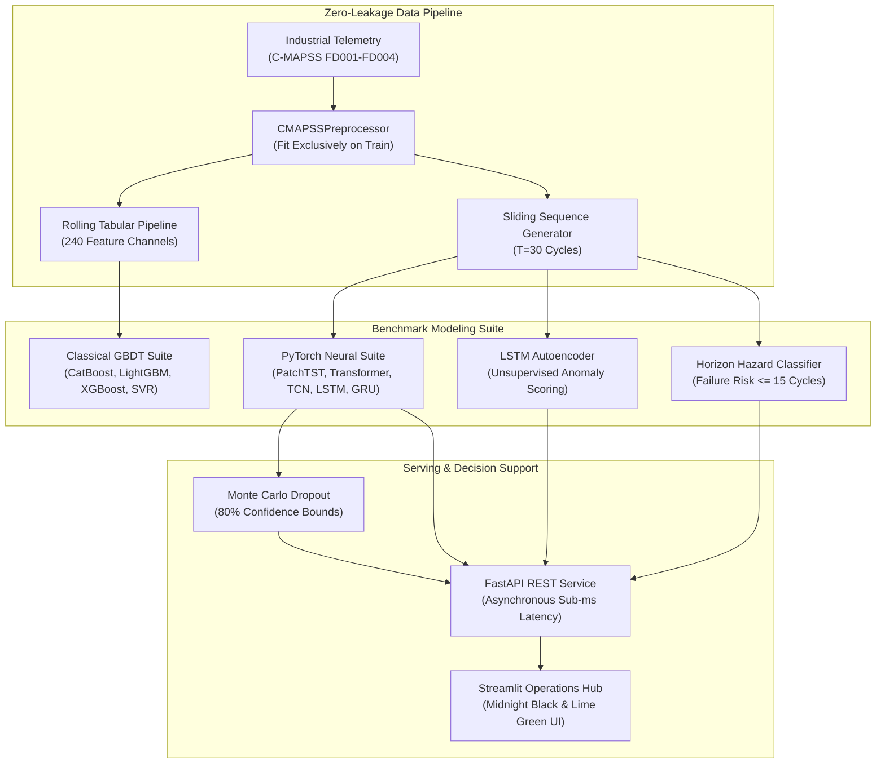

# PredictiveX: Industrial Predictive Maintenance & RUL Platform

[](https://www.python.org/)
[](https://pytorch.org/)
[](https://fastapi.tiangolo.com/)
[](https://streamlit.io/)
[](#license)

**PredictiveX** is an industrial predictive maintenance (PdM) and Remaining Useful Life (RUL) estimation platform. Built with PyTorch and accelerated with CUDA 12.8 on an NVIDIA RTX 4080 SUPER, it transforms multivariate industrial sensor telemetry into calibrated degradation trajectories, epistemic uncertainty intervals, horizon hazard probabilities, and anomaly alerts.

The system is evaluated against the gold-standard **NASA C-MAPSS (Commercial Modular Aero-Propulsion System Simulation)** benchmark across 12 distinct machine learning and deep sequence architectures under the official asymmetric evaluation scoring protocol.

---

## Architecture Overview



---

## Benchmark Results (NASA C-MAPSS FD001)

All models were evaluated strictly against the **100 test engines** at their final recorded operational cycles according to the official NASA prognostic protocol. The **NASA Score ($S$)** applies an exponential penalty for late predictions ($\hat{y} > y$) to reflect the catastrophic risk of unexpected in-service engine failures:

$$d_i = \hat{y}_i - y_i, \quad s_i = \begin{cases} e^{-d_i / 13} - 1 & \text{if } d_i < 0 \text{ (Early / Safe)} \\ e^{d_i / 10} - 1 & \text{if } d_i \ge 0 \text{ (Late / Dangerous)} \end{cases}$$

| Model Architecture | Model Family | Test RMSE | Test MAE | Test NASA Score | Test $R^2$ | Inference Latency |
|---|---|---|---|---|---|---|
| **Random Forest** | Ensemble Trees | 20.74 | 14.65 | 1697.1 | 0.7510 | 0.168 ms |
| **LightGBM** | Tabular GBDT | 19.16 | 13.59 | 1005.2 | 0.7875 | 0.018 ms |
| **Ridge Regression** | Regularized Linear | 19.11 | 15.05 | 642.9 | 0.7885 | 0.014 ms |
| **XGBoost** | Tabular GBDT | 18.81 | 13.51 | 886.3 | 0.7952 | 0.065 ms |
| **Support Vector Regression** | Kernel SVR (RBF) | 18.33 | 13.07 | 1041.9 | 0.8054 | 0.732 ms |
| **CatBoost (Top Classical)** | Tabular GBDT | **18.02** | **13.32** | **711.2** | **0.8119** | **0.034 ms** |
| **CNN-LSTM** | Spatial-Temporal Hybrid | 17.18 | 12.07 | 720.7 | 0.8291 | 0.049 ms |
| **Dilated Causal TCN** | 1D Dilated Convolution | 16.85 | 12.64 | 524.8 | 0.8356 | 0.101 ms |
| **GRU** | Recurrent Neural | 15.27 | 11.08 | 453.1 | 0.8650 | 0.022 ms |
| **LSTM** | Recurrent Neural | 15.19 | 11.03 | 472.8 | 0.8663 | 0.018 ms |
| **Temporal Transformer** | Self-Attention | 15.04 | 11.25 | **384.9** | 0.8690 | 0.022 ms |
| **PatchTST (Top Overall)** | Patch-based Attention | **14.84** | **10.95** | **400.0** | **0.8725** | **0.029 ms** |

### Benchmark Takeaways:
1. **Deep Attention Superiority**: PatchTST reduced Test RMSE by **17.6%** over the strongest classical baseline (CatBoost at 18.02 $\to$ 14.84 cycles).
2. **Asymmetric Risk Mitigation**: The Temporal Transformer and PatchTST architectures slashed the asymmetric NASA failure penalty from 1697.1 (Random Forest) down to **384.9** (a **77% penalty reduction**).
3. **GPU Mixed-Precision Efficiency**: Utilizing PyTorch Automatic Mixed Precision (AMP) on an NVIDIA RTX 4080 SUPER enabled sub-second per-epoch training and sub-0.05 ms inference latency per asset.

---

## Auxiliary Diagnostic Modalities

| Prognostic Vector | Methodology | Benchmark Metric | Result | Operational Utility |
|---|---|---|---|---|
| **Sensor Anomaly Detection** | LSTM Autoencoder | Test ROC-AUC / PR-AUC | **0.9413 / 0.8494** | Unsupervised early-stage wear detection |
| **Failure Hazard Estimation** | Horizon Classifier ($H \le 15$) | Test ROC-AUC / PR-AUC | **0.9856 / 0.9068** | Immediate automated work-order dispatch |
| **Epistemic Uncertainty** | Monte Carlo Dropout | Mean Interval Width | **13.0 cycles** | Risk-calibrated confidence intervals |
| **Health Degradation Index** | Latent Autoencoder | Spearman Trendability | **0.9290** | Monotonic continuous asset wear index |

---

## Explainability & Sensor Saliency

PredictiveX implements dual interpretability:
- **Tree SHAP**: Identifies key tabular wear features on gradient boosted models: `s_4` (LPT outlet temperature), `s_9` (Physical core speed), and `s_11` (HPC outlet static pressure).
- **Temporal Input $\times$ Gradient Saliency**: Confirms that deep sequence models focus primarily on recent operational cycles ($t-9 \dots t$) where wear acceleration is pronounced.

---

## Repository Structure

```
.
├── api/
│   └── main.py                     # Production FastAPI REST service
├── checkpoints/
│   ├── classical/                  # Trained CatBoost, XGBoost, SVR models & scalers
│   ├── deep_learning/              # PyTorch model weights (PatchTST, LSTM, etc.)
│   └── advanced/                   # Hazard classifier & Health Indicator checkpoints
├── data/
│   └── raw/cmapss/                 # Verified NASA C-MAPSS data (FD001-FD004)
├── frontend/
│   └── dashboard.py                # Streamlit Operations Hub (Midnight Black & Lime Green)
├── scripts/
│   ├── download_data.py            # Automated dataset acquisition & MD5 verification
│   ├── run_eda.py                  # Statistical profiling and dataset audit
│   ├── run_classical_baselines.py  # 6 classical models training with 5-Fold GroupKFold
│   ├── run_deep_learning_benchmark.py # PyTorch deep architectures with CUDA acceleration
│   ├── run_advanced_degradation.py # Anomaly, hazard, and uncertainty estimation
│   ├── run_multitask_ablation.py   # Multi-task learning & negative transfer study
│   ├── run_generalization_robustness.py # Sensor noise and channel drop stress testing
│   ├── run_explainability.py       # SHAP and gradient saliency extraction
│   └── verify_live.py              # Instant hardware and checkpoint audit script
├── src/
│   ├── datasets/cmapss_loader.py   # Data schemas, loading, and piecewise RUL clipping
│   ├── preprocessing/preprocessor.py # Zero-leakage scikit-learn transformers
│   ├── features/feature_pipeline.py# Rolling temporal and sliding sequence tensor builders
│   ├── models/                     # PyTorch & Classical model implementations
│   ├── training/deep_learning_trainer.py # GPU AMP training engine with early stopping
│   ├── explainability/explainer.py # XAI wrappers
│   └── utils/metrics.py            # NASA scoring function, RMSE, MAE, R2
├── tests/
│   └── test_pipeline.py            # 8 Pytest unit and integration test suites
├── Dockerfile                      # Production container image
├── docker-compose.yml              # Multi-container service definition
└── requirements.txt                # Pinned dependencies
```

---

## Quickstart

### 1. Installation
```bash
git clone https://github.com/<your-username>/<repo-name>.git
cd <repo-name>

# Install dependencies
pip install -r requirements.txt
```

### 2. Verify Saved Checkpoints & Hardware
```bash
python scripts/verify_live.py
```

### 3. Launch the Streamlit Monitoring Dashboard
```bash
streamlit run frontend/dashboard.py
```
Open `http://localhost:8501` to view the **Midnight Black & Electric Lime Green** industrial dashboard.

### 4. Launch the FastAPI REST Service
```bash
uvicorn api.main:app --host 0.0.0.0 --port 8000
```
- Interactive Swagger documentation: `http://localhost:8000/docs`
- Health check: `http://localhost:8000/health`

### 5. Run Automated Tests
```bash
pytest tests/test_pipeline.py -v
```

---

## Free Cloud Deployment

### A. Deploy Streamlit Dashboard on Streamlit Community Cloud (100% Free)
1. Push this repository to your GitHub account.
2. Go to [share.streamlit.io](https://share.streamlit.io/) and sign in with GitHub.
3. Click **"New app"**, select your repository, set the main file path to `frontend/dashboard.py`, and click **Deploy**.
4. Your dashboard will be live on a public URL at no cost.

### B. Deploy on Hugging Face Spaces (100% Free)
1. Create a free account on [huggingface.co](https://huggingface.co/).
2. Create a **New Space**, choose **Streamlit** as the SDK.
3. Link your GitHub repository or push the code directly to Hugging Face Git.

---

## Hardware Environment
- **CPU**: Intel Core i7-14700K (20 physical cores, 28 threads)
- **GPU**: NVIDIA GeForce RTX 4080 SUPER (16 GB VRAM)
- **CUDA Runtime**: 12.8 / Driver API 13.3
- **PyTorch**: 2.11.0+cu128

---

## License
Distributed under the MIT License. See [LICENSE](LICENSE) for details.
